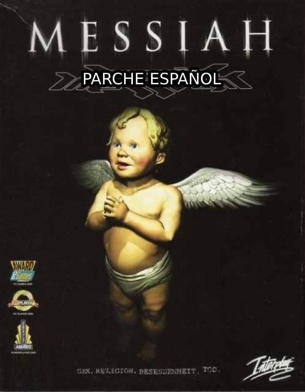

<div align="">
  
</div>

# Messiah (2003) — Parche español + guía Windows 11

Parche de traducción al español para **Messiah (2003)** de Shiny,
válido para las versiones de **GOG y Steam**. Incluye además una guía
para hacer funcionar el juego en **Windows 11**.

## Índice
- [Messiah (2003) — Parche español + guía Windows 11](#messiah-2003--parche-español--guía-windows-11)
  - [Índice](#índice)
  - [Qué traduce](#qué-traduce)
  - [Requisitos](#requisitos)
  - [Instalación con scripts (recomendada)](#instalación-con-scripts-recomendada)
  - [Instalación manual](#instalación-manual)
  - [Jugar en Windows 11](#jugar-en-windows-11)
  - [Desinstalar (volver a inglés)](#desinstalar-volver-a-inglés)
  - [Contenido del repositorio](#contenido-del-repositorio)
  - [Limitaciones conocidas](#limitaciones-conocidas)
  - [Créditos](#créditos)

## Qué traduce
- Textos y subtítulos del juego (`Messiah.spa`, `All_Spanish.txt` completo).
- Voces in-game en español (`sspeek.dta/.idx`, ~60 MB).
- Menús gráficos en español (19 imágenes `Menu\Spanish`).
- No toca las cinemáticas `.mve` salvo logos (ver Limitaciones).

## Requisitos
- Messiah instalado (GOG: `C:\GOG Games\Messiah`, o Steam).
- Windows 10/11. Permiso de Administrador (solo para fijar el idioma
  en el registro; los ficheros se copian sin él).

## Instalación con scripts (recomendada)
Doble clic en cada uno, en orden (acepta el aviso de Administrador):

1. `scripts\crear-respaldo.bat` — guarda los originales en
   `scripts\backup` (si ya existe, avisa y no lo pisa).
2. `scripts\instalar-parche-es.bat` — verifica el parche por hash,
   lo copia y fija `Language=S` en el registro (claves Shiny y GOG).
3. Juega con `scripts\jugar-messiah.bat` (ver abajo).

Si algo falla, la ventana te dice qué y no se cierra sola.

## Instalación manual
1. Haz copia de `pc\language\Spanish\All_Spanish.txt` y de los
   `pc\*.mve` del juego.
2. Copia el contenido de `patch-es\pc\` a la carpeta `pc\` del juego.
3. Fija el idioma en el registro (como Administrador):
   ```
   reg add "HKLM\SOFTWARE\WOW6432Node\Shiny\Messiah\1.00.000" /v Language /t REG_SZ /d S /f
   reg add "HKLM\SOFTWARE\WOW6432Node\GOG.com\Messiah" /v Language /t REG_SZ /d S /f
   ```
   (La segunda clave la usa el exe modificado Widescreen.)
4. Para volver a inglés: restaura tus copias y pon `Language=E` en
   ambas claves (o borra la de `GOG.com` si no existía).

## Jugar en Windows 11
El juego del 2000 necesita ayuda extra en sistemas modernos. Guía
completa paso a paso: **[docs/jugar-en-windows-11.md](docs/jugar-en-windows-11.md)**.

Resumen: desactivar Nahimic, exe Widescreen modificado, `winmm.dll`
actualizado, sin modo compatibilidad, arrancar siempre con
`scripts\jugar-messiah.bat` (D3D con `-x -i +!`), jugar en pantalla
completa y desactivar `pre-load cached files` en Opciones.

## Desinstalar (volver a inglés)
Doble clic en `scripts\restaurar-respaldo.bat` (acepta el UAC):
devuelve los ficheros originales, borra los del parche y restaura el
idioma anterior. El respaldo se conserva.

## Contenido del repositorio
```
patch-es/   Ficheros del parche (estructura espejo del juego) + FUENTES.txt
scripts/    crear-respaldo, instalar, restaurar, jugar + README de uso
docs/       Guía jugar-en-windows-11.md
images/     Portada de este README
```

## Limitaciones conocidas
- `pc\intro.mve` (intro principal) sigue en inglés: ninguna fuente lo
  traía doblado. Se añadirá cuando se consiga.
- El exe `MessiahGlide3x.exe` no arranca en Windows moderno: usa el D3D.
- En modo ventana el juego va acelerado (no tiene VSync): juega en
  pantalla completa.

## Créditos
Traducción original: edición española del juego en CD (recuperada de archivos sueltos, leer
`patch-es/FUENTES.txt`). Este repo solo ordena, verifica e instala esos
ficheros; no contiene el juego.
